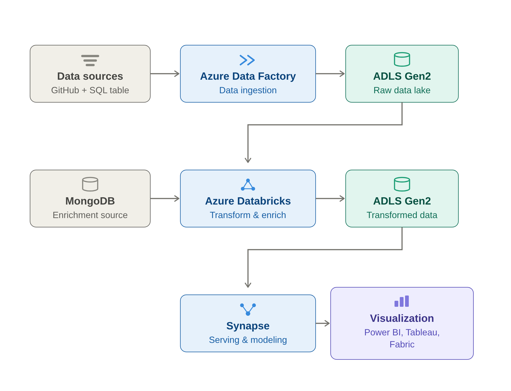
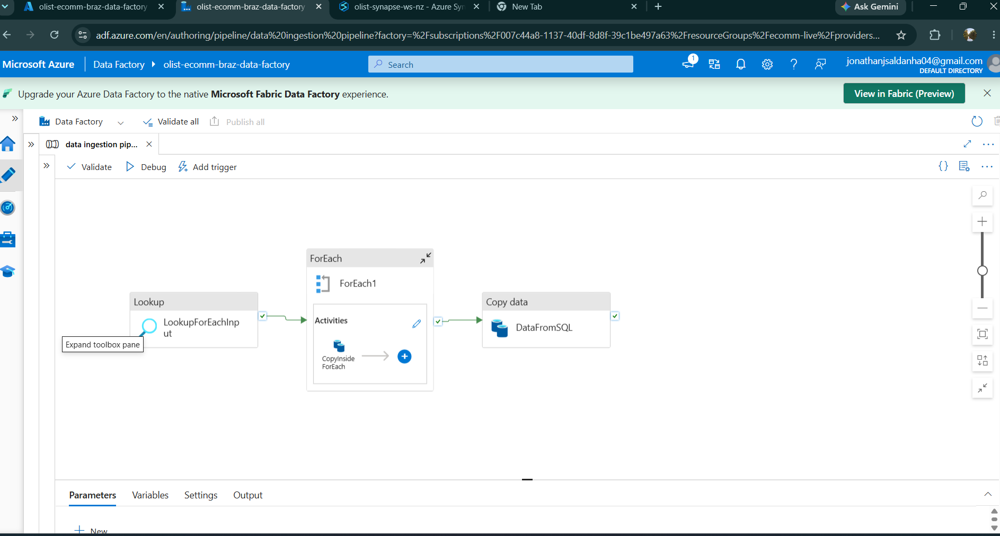
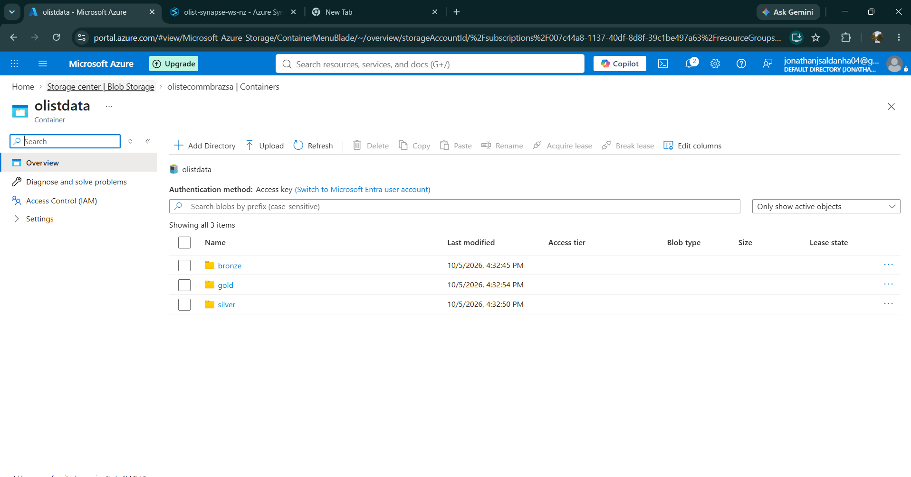
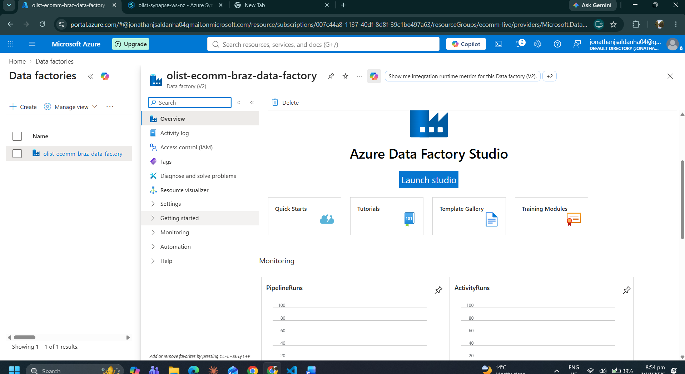
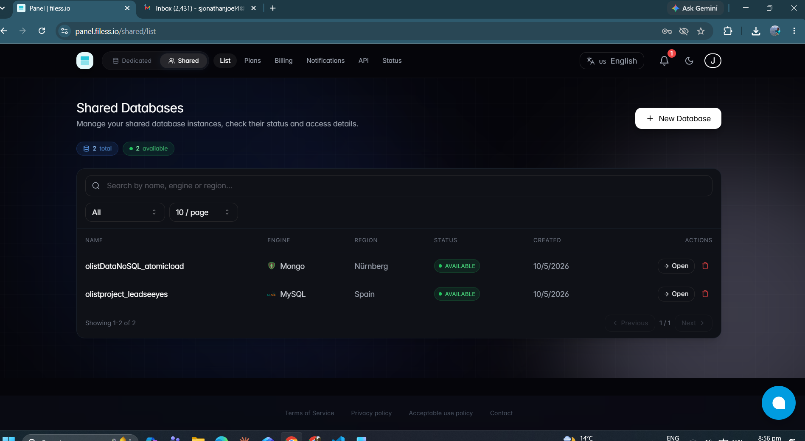

# Olist E-Commerce Data Pipeline on Azure

An end-to-end batch data engineering project on Azure. It ingests the **Brazilian Olist e-commerce dataset** from three different source systems, lands it in a **medallion-architecture data lake** (Bronze → Silver → Gold), transforms and enriches it with **Azure Databricks (PySpark)**, and serves it through **Azure Synapse Analytics serverless SQL** for BI tools.



---

## Highlights

- **Multi-source ingestion:** HTTP (GitHub raw files), a relational database (MySQL) and a NoSQL document store (MongoDB).
- **Metadata-driven ADF pipeline:** a single `Lookup → ForEach → Copy` pattern, driven by a JSON config, copies 7 files with one parameterized activity instead of 7 hard-coded ones.
- **Medallion lake** on ADLS Gen2 (`bronze/`, `silver/`, `gold/` in one container).
- **PySpark transformations:** deduplication, date typing, delivery-delay KPIs, a 6-way join and a cross-store enrichment (MongoDB → pandas → Spark).
- **Serving layer:** Synapse serverless SQL views over Parquet, plus **CETAS** (`CREATE EXTERNAL TABLE AS SELECT`) to write a curated Gold table back to the lake.
- **Secure lake access:** Databricks authenticates to ADLS Gen2 through an **Entra ID service principal (OAuth 2.0)**. Synapse uses a **Managed Identity** credential.

---

## Tech Stack

| Layer | Technology |
|---|---|
| Source systems | GitHub (HTTP), MySQL 8 and MongoDB (hosted on [filess.io](https://filess.io)) |
| Source seeding | Python, pandas, `mysql-connector-python`, `pymongo` (Google Colab) |
| Ingestion / orchestration | Azure Data Factory (V2) |
| Storage | Azure Data Lake Storage Gen2 (hierarchical namespace) |
| Transformation | Azure Databricks, PySpark |
| Serving | Azure Synapse Analytics, serverless SQL pool |
| File formats | CSV (Bronze), Parquet with Snappy compression (Silver/Gold) |
| Security | Entra ID App Registration (service principal), Managed Identity, database-scoped credentials |

---

## Dataset

[Olist Brazilian E-Commerce Public Dataset](https://www.kaggle.com/datasets/olistbr/brazilian-ecommerce): about 100k orders placed between 2016 and 2018 across several Brazilian marketplaces. It has 9 related tables.

The tables were deliberately spread across three source types to simulate a real enterprise landscape:

| Table | Source system | Ingested by | Rows |
|---|---|---|---|
| `olist_orders_dataset` | GitHub (HTTP) | ADF ForEach | ~99k |
| `olist_customers_dataset` | GitHub (HTTP) | ADF ForEach | ~99k |
| `olist_order_items_dataset` | GitHub (HTTP) | ADF ForEach | ~113k |
| `olist_products_dataset` | GitHub (HTTP) | ADF ForEach | ~33k |
| `olist_sellers_dataset` | GitHub (HTTP) | ADF ForEach | ~3k |
| `olist_order_reviews_dataset` | GitHub (HTTP) | ADF ForEach | ~99k |
| `olist_geolocation_dataset` | GitHub (HTTP) | ADF ForEach | ~1M |
| `olist_order_payments_dataset` | **MySQL** | ADF Copy (SQL source) | 103,886 |
| `product_category_name_translation` | **MongoDB** | Databricks (`pymongo`) | 71 |

---

## Repository Structure

```
.
├── architecture_diagram.png                     # End-to-end architecture
├── Images/                                      # Azure portal / ADF / filess.io screenshots
├── Notebooks/
│   ├── 1. DataIngestionToSQL.ipynb              # Seeds MySQL (payments) and MongoDB (category translation)
│   └── 2. Databricks Code for Transformation.ipynb  # Bronze → Silver PySpark transformation
└── SQL/                                         # Synapse serverless SQL (run in order)
    ├── 1. SQL on OlistData.sql                  # Explore Silver Parquet with OPENROWSET
    ├── 2. Create View.sql                       # gold schema + gold.final view
    ├── 3. View Final 2.sql                      # gold.final2: delivered orders only
    ├── 4. SQL to Gold Layer.sql                 # External file format, data source, CETAS → gold/Serving
    └── 5. finaltable Output.sql                 # Query the Gold external table
```

---

## Pipeline Walkthrough

### 0. Source setup ([Notebooks/1. DataIngestionToSQL.ipynb](Notebooks/1.%20DataIngestionToSQL.ipynb))

Two free-tier databases were provisioned on filess.io so the project could pull from real database sources, not only flat files:

- **MySQL:** the payments CSV is loaded into the `olist_order_payments` table. The notebook recreates the table (`DROP` + `CREATE`), then inserts with `executemany` in **batches of 500 rows**, committing after each batch. 103,886 rows were loaded.
- **MongoDB:** the category-translation CSV is converted to documents and loaded with `insert_many` into the `product_category_name_translation` collection, after a `delete_many({})` so reruns stay idempotent. 71 documents were loaded.

### 1. Ingestion: Azure Data Factory → Bronze



Pipeline `data ingestion pipeline` in `olist-ecomm-braz-data-factory`:

1. **Lookup (`LookupForEachInput`)** reads a JSON config array. Each entry holds a GitHub relative URL and a target file name.
2. **ForEach** iterates over the array. Inside it, one **Copy activity (`CopyInsideForEach`)** uses:
   - a **parameterized HTTP dataset** (`DataFromGithubViaLinkedServices`) on linked service `httpgithublinkedservices`, with the URL taken from `@item()`;
   - a **parameterized ADLS Gen2 delimited-text sink** (`CSVFromLinkedServicesToSink`) that writes to `bronze/<file name>`.
3. **Copy data (`DataFromSQL`)** pulls the payments table from MySQL into Bronze.

Result: **8 raw CSV files in `olistdata/bronze/`**.

This design started as one hard-coded copy activity. It was refactored into the metadata-driven pattern, so adding a new source file only needs a new JSON entry and no pipeline change.

### 2. Transformation: Azure Databricks → Silver ([Notebooks/2. Databricks Code for Transformation.ipynb](Notebooks/2.%20Databricks%20Code%20for%20Transformation.ipynb))

| Step | What happens |
|---|---|
| **Auth** | The Spark session is configured for ABFS with an OAuth client-credentials flow (App Registration: client ID, tenant ID, secret). |
| **Read** | The Bronze CSVs are read from `abfss://olistdata@olistecommbrazsa.dfs.core.windows.net/bronze/`. |
| **Enrich source** | The MongoDB collection is read with `pymongo` into pandas, `_id` is dropped, and the result becomes a Spark DataFrame. |
| **Clean** | `dropDuplicates()` and `na.drop('all')` remove duplicate rows and rows that are entirely null. |
| **Type** | Purchase, delivered and estimated-delivery timestamps are converted to `DATE`. |
| **Derive KPIs** | `actual_delivery_time`, `estimated_delivery_time` and `delay_time` (actual minus estimated, in days; positive means late). |
| **Join** | Orders ⟕ customers ⟕ payments ⟕ items ⟕ products ⟕ sellers ⟕ category translation (all left joins). |
| **Tidy** | Duplicate column names are removed. |
| **Write** | Parquet is written to `silver/` in overwrite mode. |

### 3. Serving: Azure Synapse serverless SQL → Gold ([SQL/](SQL/))

```sql
-- Live view over Silver, filtered to delivered orders
CREATE VIEW gold.final2 AS
SELECT * FROM OPENROWSET(
    BULK 'https://olistecommbrazsa.dfs.core.windows.net/olistdata/silver/',
    FORMAT = 'PARQUET') AS r
WHERE order_status = 'delivered';

-- Materialise it back to the lake as the Gold serving table (CETAS)
CREATE EXTERNAL TABLE gold.finaltable WITH (
    LOCATION = 'Serving', DATA_SOURCE = goldlayer, FILE_FORMAT = extfileformat
) AS SELECT * FROM gold.final2;
```

- **Views** (`gold.final`, `gold.final2`) are free to create, read Silver live, and cost only per TB scanned.
- **CETAS** persists a Snappy-compressed Parquet snapshot in `gold/Serving/`. BI tools then read a curated, pre-filtered dataset instead of rescanning Silver.
- Access to the lake uses a **database-scoped credential backed by the workspace Managed Identity**. This avoids storage keys or SAS tokens in SQL.

### 4. Consumption

The Gold external table can be queried from any tool that connects to the Synapse serverless SQL endpoint, such as Power BI, Tableau or Microsoft Fabric.

---

## Screenshots

| ADLS Gen2 medallion container | Data Factory |
|---|---|
|  |  |

| filess.io source databases (MySQL + MongoDB) |
|---|
|  |

---

## How to Reproduce

1. **Azure resources** (one resource group): a Storage Account with hierarchical namespace enabled, containing container `olistdata` with folders `bronze/`, `silver/` and `gold/`. Also create a Data Factory, an Azure Databricks workspace and a Synapse workspace.
2. **Source databases:** create a MySQL and a MongoDB instance (filess.io free tier works). Put their connection details in environment variables or a secrets store, then run `Notebooks/1. DataIngestionToSQL.ipynb`.
3. **Data Factory:** create an HTTP linked service (base URL: raw GitHub dataset location), an ADLS Gen2 linked service and a MySQL linked service. Build the `Lookup → ForEach(Copy)` + `Copy(SQL)` pipeline, then debug or trigger it.
4. **Databricks:** create an App Registration and grant it **Storage Blob Data Contributor** on the storage account. Store its secret in a **Databricks secret scope** (ideally backed by Azure Key Vault). Run notebook 2.
5. **Synapse:** grant the workspace Managed Identity **Storage Blob Data Contributor**. In the serverless pool create database `olist`, a master key and a scoped credential. Run `SQL/1` to `SQL/5` in order. Separate `CREATE SCHEMA` and `CREATE VIEW` with `GO`.

> **Security note:** never commit credentials. All secrets in this repo have been replaced with placeholders such as `<YOUR_CLIENT_SECRET>`.

---

## Key Design Decisions

| Decision | Why |
|---|---|
| Metadata-driven ADF (Lookup + ForEach) | One activity serves N files, and new sources are config-only changes. |
| Parquet in Silver/Gold | Columnar storage with compression and an embedded schema. Serverless SQL bills by data scanned, so Parquet directly lowers cost. |
| Serverless (not dedicated) Synapse pool | Pay-per-query, no idle compute. Fits a low-concurrency analytical workload. |
| Service principal for Databricks, Managed Identity for Synapse | Identity-based access, with no storage account keys in code. |
| MongoDB read into pandas | The translation table is tiny (71 rows), so collecting it on the driver is cheaper and simpler than adding the Mongo Spark connector. |

---

## Known Limitations and Roadmap

Being explicit about what a production version would change:

- [ ] **End-to-end orchestration:** add a Databricks Notebook activity and a Synapse script activity to the ADF pipeline, and a schedule or storage-event trigger. Today each stage runs manually.
- [ ] **Data grain:** joining both *payments* and *items* to orders multiplies rows when an order has several of each (a fan-out). Pre-aggregate payments per `order_id`, or split into `fact_order_items` and `fact_payments` with a **star schema** in Gold.
- [ ] **Explicit schemas:** CSVs are read without `inferSchema` or a `StructType`, so numeric columns land as strings. Define schemas and keep timestamps (not only dates).
- [ ] **Delta Lake** for Silver/Gold: ACID writes, `MERGE` for incremental loads, time travel and schema enforcement instead of full overwrites.
- [ ] **Incremental ingestion:** watermark-based copy from MySQL instead of a full reload.
- [ ] **Data quality checks:** row-count reconciliation between Bronze and Silver, null/key checks, and alerts on failure.
- [ ] **Secrets management:** Azure Key Vault-backed secret scope and Key Vault linked services everywhere.
- [ ] **CI/CD:** ADF Git integration, ARM/Bicep templates, and Databricks Repos / Asset Bundles.
- [ ] **Use the remaining data:** join reviews (customer satisfaction vs. delay) and geolocation (regional delivery performance).
- [ ] **Power BI dashboard** on top of `gold.finaltable`.

---

## Author

**Jonathan Joel Saldanha** · [LinkedIn](https://www.linkedin.com/in/jonathanjoelsaldanha/) · [GitHub](https://github.com/jjs04)
